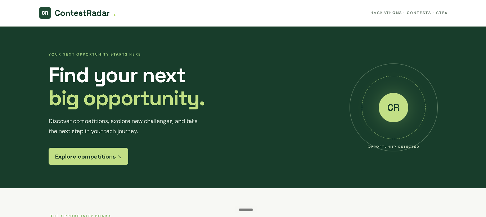
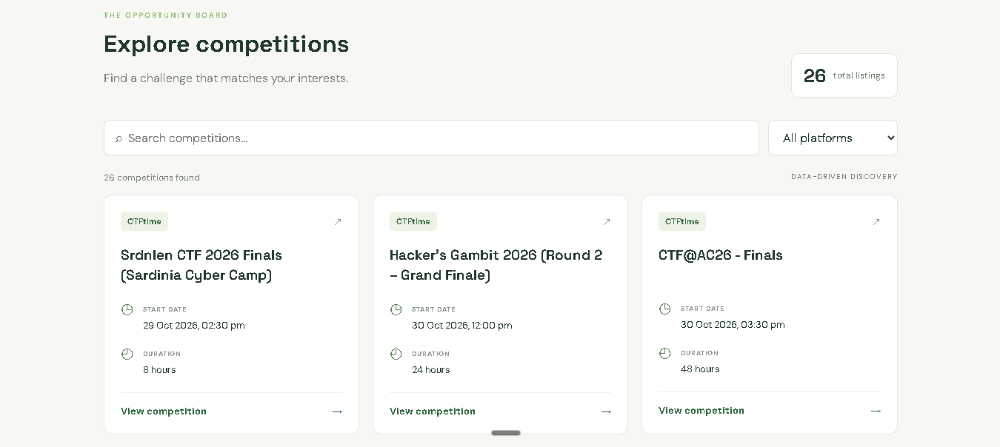
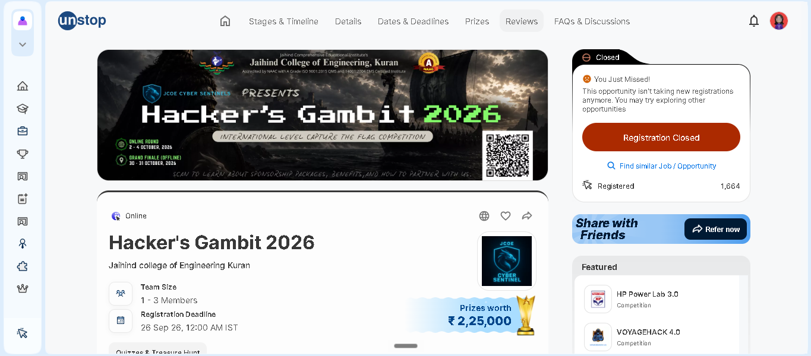

# 🎯 ContestRadar – Live Competition & Deadline Tracker

ContestRadar tracks programming competitions and cybersecurity events in one place. It collects, validates, and organizes competition data to help students and developers discover upcoming events.

## 🌟 Project Overview

Finding competitions across different platforms can be time-consuming. ContestRadar aims to simplify competition discovery by bringing event information together in one place using official APIs.

## ✨ Features

- 💻 Programming contests from Codeforces.
- 🔐 Cybersecurity events from CTFtime.
- 🧹 Competition data validation and cleaning.
- 🗃️ Structured data storage using SQLite.
- 🧪 Automated tests for parsing and database operations.
- 📊 A dashboard for viewing competition information.

## 📸 Project Screenshots

### 🏠 Homepage



### 🏆 Competitions



### 💡 Example



## 🛠️ Technologies Used

- Python
- React and Vite
- SQLite
- Codeforces API
- CTFtime API
- Git and GitHub
- Python unittest

## 🔗 Data Sources

- **Codeforces API:** https://codeforces.com/api/contest.list
- **CTFtime API:** https://ctftime.org/api/v1/events/

## 📂 Project Structure

```text
ContestRadar-Cybernaut/
├── collector/
│   └── api_collector.py
├── fixtures/
│   └── raw_data.json
├── docs/
│   ├── screenshots/
│   │   ├── homepage.PNG
│   │   ├── competitions.PNG
│   │   └── example.PNG
│   ├── accuracy_check.csv
│   ├── data_dictionary.md
│   └── project_report.md
├── tests/
├── app.py
├── database.py
├── parser.py
├── run_pipeline.py
├── schema.sql
├── requirements.txt
├── clean_data.json
├── test_parser.py
└── test_database.py
```

## ⚙️ Getting Started

### 1. Clone the repository

```bash
git clone https://github.com/sureka-dev/ContestRadar-Cybernaut.git
cd ContestRadar-Cybernaut
```

### 2. Install dependencies

```bash
pip install -r requirements.txt
```

### 3. Run the data pipeline

```bash
python run_pipeline.py
```

### 4. Run automated tests

```bash
python -m unittest test_parser.py test_database.py -v
```

## 🧪 Testing

The project includes tests for data parsing, validation, invalid records, duplicate handling, and database operations. The test suite previously passed 24 tests.

## 🔄 Data Processing Workflow

1. Collect competition data from supported APIs.
2. Parse and validate the records.
3. Reject records that fail validation.
4. Store and organize valid records.
5. Save the cleaned dataset.

## 🚀 Future Improvements

- Add more official competition APIs.
- Improve search and filtering.
- Add deadline reminders.
- Expand competition categories.
- Improve mobile responsiveness.
- Extend automated testing and data accuracy checks.

## 👥 Team Project

**Project:** ContestRadar – Live Competition & Deadline Tracker

A collaborative project focused on API-based data collection, data processing, database management, and competition discovery.

## 📄 License

This project is intended for educational and development purposes.
